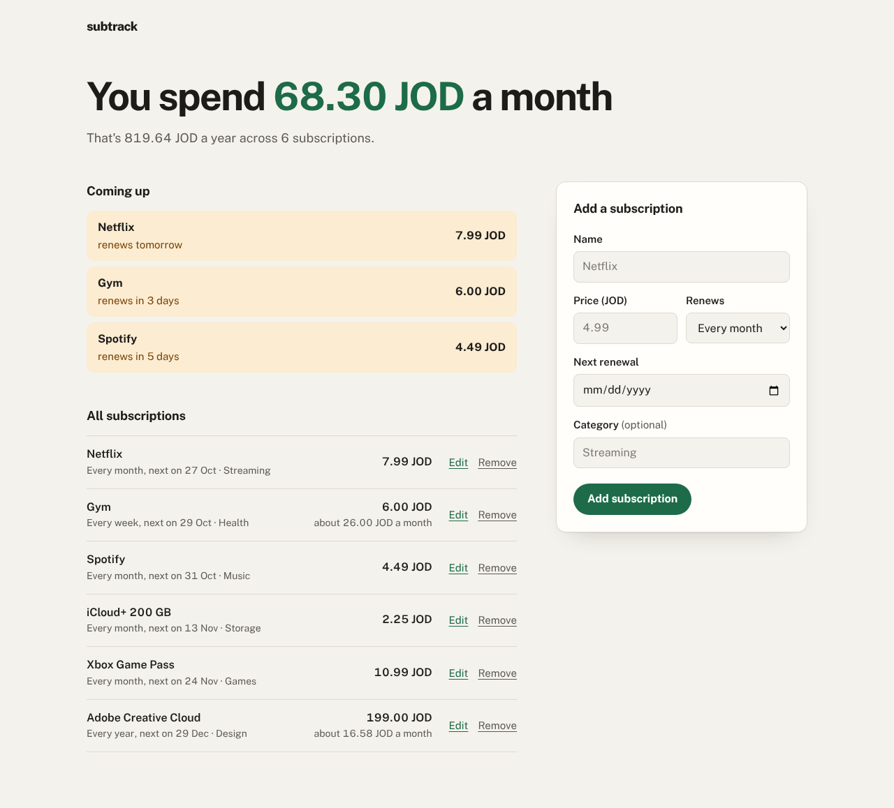

# subtrack

A small web app for keeping track of your subscriptions. Add what you pay for and subtrack tells you what it all costs each month and each year, and shows what renews in the next few days so nothing catches you out.



## What it does

- Add, edit and remove subscriptions, with a price, how often they renew and the next renewal date.
- Shows your monthly and yearly total. Weekly and yearly plans are converted to a monthly cost, so everything adds up properly.
- Lists anything renewing in the next 7 days at the top.
- When a renewal date passes, it moves on to the next one by itself.
- Friendly messages for mistakes in the form, and a plain error page if the database can't be reached.
- Works on phones, and follows your light or dark setting.

## Built with

Plain PHP 8 and MySQL (or MariaDB) through PDO. No framework and no JavaScript build step.

Forms are protected with a CSRF token, every query uses prepared statements and all output is escaped.

## Run it yourself

You need PHP 8.1 or newer with the `pdo_mysql` extension, and a MySQL or MariaDB server.

1. Create a database and a user for it, then load the table:

   ```sql
   CREATE DATABASE subtrack;
   CREATE USER 'subtrack'@'localhost' IDENTIFIED BY 'pick-a-password';
   GRANT ALL ON subtrack.* TO 'subtrack'@'localhost';
   ```

   ```bash
   mysql -u subtrack -p subtrack < schema.sql
   ```

2. Copy `config.example.php` to `config.php` and fill in your database details. You can also change the currency and how many days ahead "Coming up" looks.

3. Start PHP's built-in server and open http://localhost:8000:

   ```bash
   php -S localhost:8000 -t public
   ```

## Files

- `public/` is the only folder the web server should serve: the pages, the stylesheet and the font.
- `src/app.php` holds the shared setup and helpers.
- `views/` holds the page templates.
- `schema.sql` creates the table.

## License

MIT
